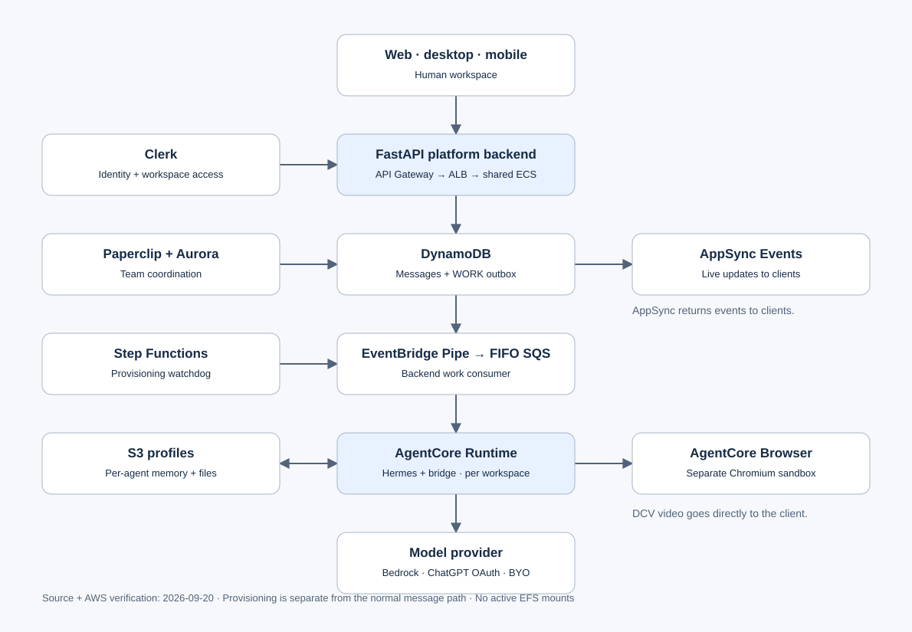
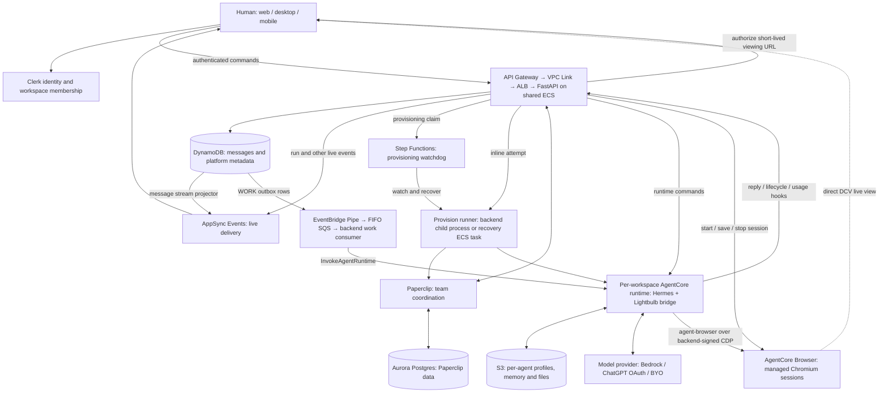

# Lightbulb architecture

Verified against source `0bc33fb6a1569e63f781f69dc14fe2655e73edab` and read-only AWS observations on 2026-09-20. This describes the shipped system; the browser section was re-checked against source on 2026-09-27.

## The system at a glance

Detailed Mermaid diagram source

## What happens when you send a message

1. The client sends a Clerk-authenticated command. FastAPI derives workspace ownership and checks access; the client cannot nominate an arbitrary owner.
2. DynamoDB is the canonical ordered message store. AppSync delivers live updates to subscribed clients. Chat clients do not connect directly to Hermes.
3. Work outbox rows feed an EventBridge Pipe and FIFO SQS queue. The backend work consumer invokes the workspace's AgentCore runtime. The bridge restores the target agent's profile and runs Hermes with that agent's context and credentials.
4. Hermes calls the selected model and tools. AgentCore hosts execution; it is not the model provider. Friday's verified production path used ChatGPT OAuth with `gpt-5.6-sol`.
5. Replies, attachments, lifecycle and usage travel back through authenticated backend hooks. Mutable agent profile state is synchronized to S3.

Source: [runtime transport](../../apps/backend/core/services/runtime_transport.py), [bridge turn](../../apps/infra/hermes/bridge/turn.py), [profile synchronization](../../apps/infra/hermes/bridge/sync.py).

The queue separates accepting a message from executing it. The message projector and work dispatcher independently consume DynamoDB changes; live delivery does not wait for the agent to finish. The worker is still named [`openclaw_work.py`](../../apps/backend/core/services/openclaw_work.py), but it dispatches to Hermes.

## Isolation and durable state

One AgentCore runtime belongs to one workspace, with distinct profiles for its agents. Turns for the same agent are serialized; different agents can run concurrently. This is not one runtime per agent.

| State | Authority |
| --- | --- |
| Human identity and organization membership | Clerk |
| Ordered messages and platform metadata | DynamoDB |
| Team roster, issues and coordination | Paperclip and Aurora |
| Agent profiles, saved files and memory | S3 under `<owner>/hermes/<agent>/` |
| Local working files during execution | Ephemeral AgentCore runtime filesystem |
| Browser tabs and unsaved website state | Current AgentCore Browser session |

Runtime uploads exclude backend-owned configuration and secrets; profile revisions allow the bridge to refresh changed backend configuration. An agent's saved file state is separate from browser cookies and website login state.

## Provisioning and recovery

The backend claims a workspace row and starts its Step Functions watchdog before running an inline provisioning attempt. The runner seeds Paperclip and provisions the Hermes runtime and profiles. The watchdog observes progress and can launch a temporary ECS provisioner task to retry failures. Stable claims and attempt tokens fence competing attempts.

Normal chat turns bypass Step Functions. Its remaining role is durable provisioning recovery, not model orchestration. A crash between claiming the row and starting the watchdog still relies on later status polling and stale-lease recovery; there is no general reconciliation sweep.

Source: [dispatcher](../../apps/backend/core/services/provision_dispatch.py), [runner](../../apps/backend/scripts/provision_runner.py), [infrastructure](../../apps/infra/lib/stacks/service-stack.ts).

## Browser

Chromium runs in AgentCore Browser (`aws.browser.v1`), separate from the Hermes runtime: one browser session and one Browser Profile per workspace. The backend owns the session (`browser_control.py`): it starts it, signs the automation (CDP) and live-view addresses with its own credentials, saves and stops it. The bridge acquires the signed CDP address from `POST /internal/browser/<owner>/acquire` (one lease for the whole bridge) and holds the ONE automation connection AWS admits; its loopback multiplexer (`bridge/cdp_mux.py`) gives every run its own endpoint and tab, so agent-browser, Hermes's CDP supervisor and `browser_cdp` of concurrent runs share it (agent-browser's own AgentCore provider is not used). `computer_use` drives the session's real screen through `InvokeBrowser` (`cua_driver.py`). The backend verifies session readiness and profile ownership (`owns_session`) before issuing a five-minute live-view URL; the client receives DCV video directly from AWS.

Browser v2 is shared like a screen (`browser_control.py`, owner ruling 2026-09-26). There is no human lease, take-control or hand-back: a person's clicks and keys go straight through the DCV live view while an agent works, and the automation stream stays enabled. The panel posts a throttled `POST /browser/input` (at most every 2 s), stored as `human_input_at` beside the fenced `browser_state` map. The agent's bridge hook (`bridge/browser_control.py`) yields: while a person acted in the last 3 s its next browser action waits (bounded at 10 s, inside a 20 s hook budget), and any action after a person's input needs a fresh snapshot. Page-script evaluation (`browser_console` with an expression, `browser_cdp`) is refused, because people sign in in this browser and a script could read a typed password. Agent runs still fence each other with a short run lease (AWS admits one automation connection per session); a second run waits `ACQUIRE_WAIT_SECONDS` (10 s) for the lease, then is refused (409); the lease is per run, so two turns of one agent also wait on each other. Saving is automatic: at every agent turn's release, ~10 s after a person's last input (the `browser_autosave` sweeper, skipped while a run is connected), and on Stop (any member; it revokes a connected agent first). Lifetime is ours: AWS's `sessionTimeoutSeconds` is a TTL regardless of activity (a session in use died at exactly createdAt + 3600 s in prod, 2026-09-26), so sessions start at the 28800 s maximum and the same sweeper saves-then-stops a browser with no run and no human input for `IDLE_STOP_SECONDS` (30 min; it stops even if that save fails, keeping the last completed one). A session that ends anyway is replaced by the next agent acquire (from `idle` or `error`), the open panel's `/browser/viewing` heartbeat, or a click in the panel, restoring the last save (a cold start runs in the background; callers poll `starting`); the panel names the reason (`endedReason` idle/expired) and turns a save running past 30 s into "Save failed" with Retry.

Source: [browser authorization](../../apps/backend/core/services/browser_sessions.py), [panel](../../apps/frontend/src/components/workspace/panels/BrowserDockPanel.tsx), [verification runbook](../runbooks/local-dev-browser-verification.md).

## What remains on ECS, and what happened to EFS

Live checks in `us-east-1` found two backend tasks and one Paperclip task in each Lightbulb environment. Their task definitions and both provisioning task definitions have no volumes. Workspace agent execution uses AgentCore.

One retained filesystem, `fs-0d6e8fc1351dce5c8`, remains with 24,576 reported bytes, zero mount targets and zero access points. It is not an active mount in those workloads. This is a scoped observation, not an all-region inventory or approval to discard historical data.

OpenClaw-shaped module names and stored identifiers can remain live compatibility contracts. Their names alone do not imply an old agent runtime is still running.

## Billing, credentials, and other entry points

Stripe handles subscriptions and marketplace payments. Subscription/provider/credit gates decide whether a turn may run. Runtime usage callbacks update DynamoDB analytics counters; metered Bedrock billing flows through the meter Lambda and Metronome, not those analytics counters. ChatGPT OAuth and BYO-key inference use their configured provider paths.

AWS Secrets Manager holds BYO keys and platform secrets. Credential materializers project the owner's permitted credentials into the appropriate agent profile. Paperclip owns team coordination, while DynamoDB remains the platform's message and metadata store; neither database replaces the other.

Scheduled work and external integrations enter through their existing backend services and eventually the runtime transport. The paired-device gateway is a separate machine protocol, not a human chat connection or the new DCV browser stream. Restoring desktop-node execution is separately assigned backlog work; retained gateway infrastructure alone does not establish end-to-end desktop execution readiness.

## Delivery and remaining work

Source changes deploy through CI/CD. Main updates dev; production requires workflow dispatch. Hermes image builds publish a candidate tag. Updating an image pin affects new runtimes; existing runtimes require the separate rollout procedure.

The migration's functional closeout is marketplace install provenance and its dependent UI. Stable Paperclip creation keys and owner-wide deploy locking already protect retries. IAM prefix cleanup and stale documentation are separate housekeeping. Browser v2 is new capability, not evidence that the runtime migration failed.

The [Graphify export](graphify/README.md) provides code relationships and its extraction limits. This diagram is source-reviewed architecture; graph edges alone do not prove live AWS behavior.
