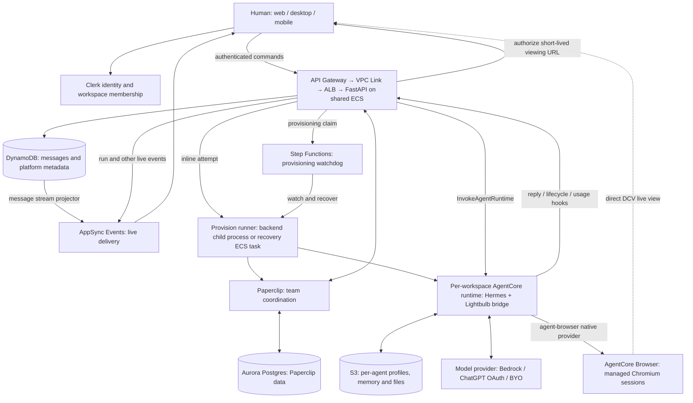

# Lightbulb architecture

Verified against source `0bc33fb6a1569e63f781f69dc14fe2655e73edab` and read-only AWS observations on 2026-09-20. This describes the shipped system, not proposed browser v2 behavior.

## The system at a glance

## What happens when you send a message

1. The client sends a Clerk-authenticated command. FastAPI derives workspace ownership and checks access; the client cannot nominate an arbitrary owner.
2. DynamoDB is the canonical ordered message store. AppSync delivers live updates to subscribed clients. Chat clients do not connect directly to Hermes.
3. The backend invokes the workspace's AgentCore runtime. The bridge restores the target agent's profile and runs Hermes with that agent's context and credentials.
4. Hermes calls the selected model and tools. AgentCore hosts execution; it is not the model provider. Friday's verified production path used ChatGPT OAuth with `gpt-5.6-sol`.
5. Replies, attachments, lifecycle and usage travel back through authenticated backend hooks. Mutable agent profile state is synchronized to S3.

Source: [runtime transport](../../apps/backend/core/services/runtime_transport.py), [bridge turn](../../apps/infra/hermes/bridge/turn.py), [profile synchronization](../../apps/infra/hermes/bridge/sync.py).

## Isolation and durable state

One AgentCore runtime belongs to one workspace, with distinct profiles for its agents. Turns for the same agent are serialized; different agents can run concurrently. This is not one runtime per agent.

| State | Authority |
| --- | --- |
| Human identity and organization membership | Clerk |
| Ordered messages and platform metadata | DynamoDB |
| Team roster, issues and coordination | Paperclip and Aurora |
| Agent profiles, saved files and memory | S3 under `<owner>/hermes/<agent>/` |
| Local working files during execution | Ephemeral AgentCore runtime filesystem |
| Browser tabs and unsaved website state | Current AgentCore Browser session |

Runtime uploads exclude backend-owned configuration and secrets; profile revisions allow the bridge to refresh changed backend configuration. An agent's saved file state is separate from browser cookies and website login state.

## Provisioning and recovery

The backend claims a workspace row and starts its Step Functions watchdog before running an inline provisioning attempt. The runner seeds Paperclip and provisions the Hermes runtime and profiles. The watchdog observes progress and can launch a temporary ECS provisioner task to retry failures. Stable claims and attempt tokens fence competing attempts.

Normal chat turns bypass Step Functions. Its remaining role is durable provisioning recovery, not model orchestration. A crash between claiming the row and starting the watchdog still relies on later status polling and stale-lease recovery; there is no general reconciliation sweep.

Source: [dispatcher](../../apps/backend/core/services/provision_dispatch.py), [runner](../../apps/backend/scripts/provision_runner.py), [infrastructure](../../apps/infra/lib/stacks/service-stack.ts).

## Browser v1 and the v2 boundary

Chromium runs in AgentCore Browser, separate from the Hermes runtime. The released `agent-browser@0.38.1` provider creates and controls its sessions using AWS-authenticated automation connections. One Browser Profile identifies the workspace.

The backend verifies session readiness and profile ownership before issuing a five-minute live-view URL. The client receives DCV video directly from AWS. The current panel neither starts a browser nor exposes a control toggle. Hidden controls do not establish that DCV rejects keyboard/mouse input; that still needs a live test.

The CLI does not save the profile before closing, so v1 does not provide cross-session website-login persistence. Its native provider also lacks attach-by-existing-session-id. Browser v2 must prove save/restore and human/agent session ownership before promising seamless handoff.

Source: [browser authorization](../../apps/backend/core/services/browser_sessions.py), [panel](../../apps/frontend/src/components/workspace/panels/BrowserDockPanel.tsx), [verification runbook](../runbooks/local-dev-browser-verification.md).

## What remains on ECS, and what happened to EFS

Live checks in `us-east-1` found two backend tasks and one Paperclip task in each Lightbulb environment. Their task definitions and both provisioning task definitions have no volumes. Workspace agent execution uses AgentCore.

One retained filesystem, `fs-0d6e8fc1351dce5c8`, remains with 24,576 reported bytes, zero mount targets and zero access points. It is not an active mount in those workloads. This is a scoped observation, not an all-region inventory or approval to discard historical data.

OpenClaw-shaped module names and stored identifiers can remain live compatibility contracts. Their names alone do not imply an old agent runtime is still running.

## Delivery and remaining work

Source changes deploy through CI/CD. Main updates dev; production requires workflow dispatch. Hermes image builds publish a candidate tag. Updating an image pin affects new runtimes; existing runtimes require the separate rollout procedure.

The migration's functional closeout is marketplace install provenance and its dependent UI. Stable Paperclip creation keys and owner-wide deploy locking already protect retries. IAM prefix cleanup and stale documentation are separate housekeeping. Browser v2 is new capability, not evidence that the runtime migration failed.

The [Graphify export](graphify/README.md) provides code relationships and its extraction limits. This diagram is source-reviewed architecture; graph edges alone do not prove live AWS behavior.
