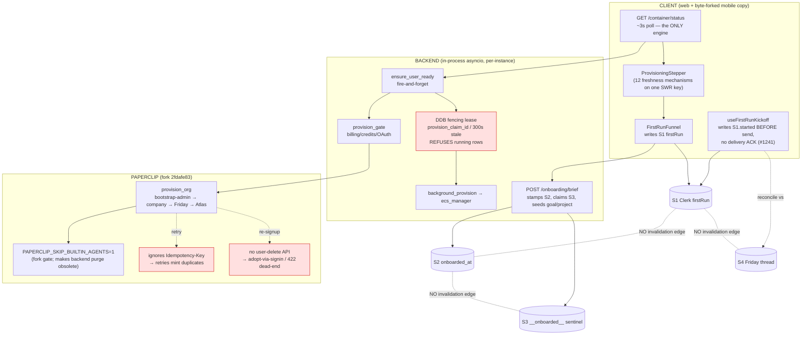
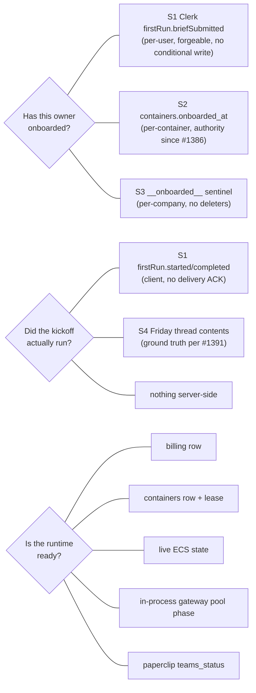

# Onboarding & Provisioning — Current-State Research

**Issue:** #1406 (P0 RFC: long-term onboarding architecture). Cross-references #1407 (provisioning executor), #1408 (client sync), #1409 (Paperclip contract).
**Date:** 2026-07-24
**Branch:** `claude/onboarding-issues-review-tjgj4b`
**Method:** 16-agent parallel investigation + completeness critic + 6 gap-fill passes, every claim cited to file:line against `origin/main` @ 2026-07-23 (includes overnight PRs #1383–#1405). Fork claims verified against `Isol8AI/paperclip` @ `2fdafe83` (= `v2026.7-isol8.5`, the exact dev+prod pin) and `openclaw/openclaw` fork source.

> **Scoping note (no users):** The platform currently has zero real users. Every "migration/backfill" concern below collapses to **wipe-and-reprovision**. This document records the current state faithfully; the companion spec targets the end-state directly without coexistence machinery.

---

## 1. The one-sentence problem

**"Has this owner onboarded, and is their runtime ready?" has no single owner.** Readiness truth is *composed per-request* from five backend stores; onboarding truth is *duplicated* across four-plus stores with no invalidation edges between them; and roughly 14 of the ~20 overnight PRs were compensating layers papering over the seams pairwise rather than fixing the split.

---

## 2. Current-state map

### 2.1 The stores of truth

| # | Store | Scope | Answers | Writers | Readers | Recreatable? |
|---|-------|-------|---------|---------|---------|--------------|
| S1 | Clerk `user.unsafeMetadata.firstRun` `{briefSubmitted, started, completed, path}` | **per-user, forever** | "did this user do the funnel / kickoff / first run" | `firstRun.ts:39-49` (web) + byte-identical mobile copy; `useGetStarted.ts:134-145` | `useFirstRunKickoff`, `FirstRunGate`, `ProvisioningStepper`, `GetStarted` | **No** — survives everything short of Clerk user delete |
| S2 | `containers.onboarded_at` (DDB) | per-container | "funnel done" (display gate) | `onboarding.py:319` (best-effort, sole) | `container.py:554` (sole) | **Yes** |
| S3 | `paperclip-companies` `__onboarded__:{company_id}` sentinel (DDB) | per-company | "goal/project seeded" (seed claim) | `paperclip_repo.py:551-770` (claim/record/release) | seed path | **Yes** (but **zero deleters exist**) |
| S4 | Friday's default-agent thread (Paperclip/Aurora) | per-agent | "kickoff actually delivered" (ground truth per #1391) | agent runtime | `useFirstRunKickoff.ts:57-87` | **Yes** |
| S5 | EFS `BRIEF.md` + `BOOTSTRAP.md` + `workspace-state.json` | per-agent-workspace | brief content + bootstrap file presence | `onboarding_brief.py:359-378`, `friday_identity.py:858-936` | OpenClaw runtime | **Yes** |

Plus five **readiness** stores composed per-request by `GET /container/status` (`container.py:220-515`): billing-accounts row, containers row (status/substatus/lease), live ECS/Cloud Map state, the **in-process** gateway pool phase, and paperclip-companies `teams_status`.

### 2.2 Lifecycle diagram (as-built)

The dashed "NO invalidation edge" lines are the disease. Every recreation path where one store moves and another doesn't is a latent bug; §4 ranks them.

---

## 3. Provisioning executor (feeds #1407)

- **PR #1388 (Step Functions) is NOT merged.** Zero `stepfunctions`/`StartExecution`/`StateMachine` code exists on main. Current executor is 100% in-process asyncio over a DDB fencing-lease (`provision_claim_id` + `provision_claimed_at`, 300s staleness, `container_repo.py:130-397`), driven entirely by the `GET /container/status` 3s poll.
- **24 provisioning triggers** enumerated (`provisioning-executor.md` §2): status-poll (no-row/error-retry/stopped-wake/stale-lease/running-repoll), `POST /container/wake`, silent chat-send wake (`websocket_chat.py:2011`), `/teams` lazy provision, provider-change cold path, Stripe trial→paid conversion + its self-heal, admin reprovision/start, dev debug POST/PATCH/DELETE, two boot-lifespan reconcilers, the idle reaper. Clerk webhooks provision nothing. Personal→org has **no dedicated path**.
- **Process-death recovery = 6 stacked compensating layers** — the strongest argument for a durable orchestrator.
- **Two doors bypass the lease:** dev debug endpoints; and a **second, undocumented autoprovision trigger** at `paperclip_proxy.py:918-957` keyed on `user_id` (not `owner_id`), violating the "one trigger only" invariant.
- **PR #1385 delivered the honest-failure state** (best-effort seed, 422-as-durable-failure, `classify_provision_error`, terminal vs `error_retrying` substatus).

---

## 4. Ranked latent bugs (requirement 2)

| ID | Bug | Trigger | Consequence | Evidence |
|----|-----|---------|-------------|----------|
| **L1** | `already_submitted` never restamps `onboarded_at` | container row recreated + company preserved | funnel every session (a same-session frontend latch only *cosmetically* masks it for a fresh submitter; a returning owner whose `briefSubmitted` is already true sees it every reload), kickoff suppressed — **verified HOLDS** | `onboarding.py:117-132` returns before stamp at `:318-321`; `onboarding.py:319` is the **sole** writer of `onboarded_at` (grep-confirmed) |
| **L2** | `upsert` drops run/generation facts | one swallowed `describe_services` failure diverts to full-provision branch | drops `onboarded_at`, `stop_reason`, `parked_at`, `bedrock_revoked`, conversion stamps; kill-switch escapes next provision | `container_repo.py:99-127`; swallow at `ecs_manager.py:1751-1753`; 2 moto tests |
| **L3** | Org departure → cross-org reconcile (destruction **fenced by Paperclip authz**) | seat-only ex-member re-enters personal context | `:306` predicate **lacks org-scope** and adopts the org's `company_id`, but the re-signed-in session is **not** privileged (fork `archiveMember` deletes grants + archives membership → `create_agent` 403 → `friday_agent_id` None → `_purge_builtin_agents` gated off at `:590`). **Real residual:** row re-points to `failed`, **30-day purge timer silently dropped**. Destruction reopens only on the `member_id`-None anomaly branch (`:978-993`). **Verified: no cross-tenant deletion — REFUTED as stated, downgraded.** Fix: add `and existing.org_id == owner_id` to `:306` (own-side defense-in-depth) | gap-3 + verification; `paperclip_provisioning.py:306,590`; fork `access.ts:387-405`, `authorization.ts:661-668` |
| **L4** | Mobile never re-onboards | reprovision with surviving Clerk user | `FirstRunGate.tsx:117` gates on durable `briefSubmitted`; #1386 fix never ported (only #1391+#1397 were, in #1404) | `FirstRunGate.tsx:86,117` |
| **L5** | Cross-cycle kickoff re-fire | `already_submitted` writes `started:true` | fires into a later empty **default-agent** thread (`agentId===defaultId` narrows *which* thread but not *whether* it misfires — a new org member's own default-agent session is empty); `completed:true` from any agent turn disarms reconcile — **verified HOLDS** | `useFirstRunKickoff.ts:57-87` (`:75` agentId gate); `AgentChatWindow.tsx:255-266` |
| **L6** | Personal→org row re-point orphaning | conversion | final `repo.put` re-points per-user row at org company, orphaning personal company/goal/Friday; stale `openclaw.json` agent-ids linger | `paperclip_provisioning.py:285-291,633-651` |
| **L7** | Burned email 422 dead-end | wipe/purge deletes password copy while account survives | re-signup hits unrecoverable Better-Auth 422; poisons email for personal + future org | gap-3; `paperclip_provisioning.py:1063-1067` |
| **F1** | Cold provider change no-ops on running container | any BYO transition or →bedrock on a running container | new provider on billing row + owner-facts only; live container keeps old provider indefinitely; oauth→byo actively breaks it | committed probe `test_change_provider_cold_running_container.py`; `billing_service.py:1187-1189` vs `container_repo.py:178-181` |

**F1 and L2 have committed regression tests** pinning current (buggy) behavior.

---

## 5. Bootstrap semantics (requirement 6) — verified against OpenClaw fork

**isol8's pre-marking of `setupCompletedAt` makes the seeded `BOOTSTRAP.md` inert** — verified HOLDS against the pinned fork `/workspace/agent` @ `66db9836` (= `v2026.7.2-isol8.1`, the deployed dev+prod base). isol8 writes `setupCompletedAt` up front (`friday_identity.py:858-872`) to stop the boot reconcile from `rm`-ing BOOTSTRAP.md over customized IDENTITY/SOUL/USER. That forces the workspace bootstrap status to `complete`, and the runtime silences BOOTSTRAP.md at **two independent gates**:

1. **Content-level (the decisive one):** `filterCompletedWorkspaceBootstrapFile` (`bootstrap-files.ts:255-280`, gated on `setupCompletedAt` via `isWorkspaceSetupCompleted`, `workspace.ts:624-627`) **strips the BOOTSTRAP.md entry out of the loaded file list before routing ever sees it**. This defeats the one path that could have rescued injection — `resolveWorkspaceBootstrapRouting`'s `workspaceBootstrapPending || hasBootstrapContent` OR-clause (`bootstrap-routing.ts:86`) — because `hasBootstrapContent` has no file left to find, no matter that the physical file sits on EFS with real content.
2. **Mode-level + call-site:** `resolveBootstrapMode` returns `"none"` when not pending (`bootstrap-mode.ts:19-20`) → `includeBootstrapInSystemContext=false` (`bootstrap-routing.ts:60`), and `attempt-bootstrap-prepare.ts:140-142` re-filters any surviving BOOTSTRAP.md path from `contextFiles`.

`resolveWorkspaceBootstrapStatus` (`workspace.ts:629-643`) returns `"complete"` on a non-empty `setupCompletedAt` **before even checking file existence**. So the seeded BOOTSTRAP.md reaches Friday's system prompt via **no code path** — it is neither the upstream birth ritual (suppressed) nor an injected context file (filtered), and its own copy tells her not to read it. The runtime's two legitimate ways to clear "pending" — agent deletes BOOTSTRAP.md, or profile-divergence evidence — are both unreachable because `reconcileWorkspaceBootstrapCompletionState` (`workspace.ts:443-489`) is forfeited twice over (own early-return `:450-455` + caller guard `:880`).

**Requirement 6 implication:** bootstrap delivery is a state isol8 *forfeits*, not a first-class operation. The fix is either (a) seed BOOTSTRAP.md *without* pre-marking `setupCompletedAt` and let the runtime's own completion detection fire, or (b) own first-run semantics entirely (drop the native BOOTSTRAP.md, drive the welcome content through an isol8 server-owned mechanism with explicit run/completion state) rather than writing a file the runtime is guaranteed never to surface.

**Adjacent standing fragility (higher stakes than the injection question).** The seeded `.openclaw/workspace-state.json` is the *retired legacy* path; the runtime reads state from SQLite and migrates the legacy file on every boot via `openclaw doctor --fix` (isol8 Dockerfile startup Step C3, `apps/infra/openclaw/Dockerfile:551`). The importer's `parseIsoTimestamp` (`state-migrations.workspace-setup-store.ts:60-72`) requires `parsed.toISOString() === value` byte-for-byte; an invalid timestamp **skips the import, leaving the legacy file in place, and `assertNoUnmigratedWorkspaceState` then throws on *every* agent turn** (`workspace-legacy-state.ts:156-182`) — a full outage, not merely an inert file. This is exactly the failure PR #1394 fixed with `js_iso_now()` (`friday_identity.py:39-55`, output matches the validator byte-for-byte). Any future upstream bump to `WORKSPACE_SETUP_STATE_VERSION`, the allowed-field set, or the timestamp contract silently reintroduces it — the RFC should add a CI/chaos check asserting isol8's seeded JSON round-trips through the pinned fork's `parseSetup` validator.

---

## 6. The two fork-fixable roots (feeds #1409)

Nearly the entire Paperclip defensive stack (~48–90 constructs) traces to **two** upstream gaps — and **we own the fork**:

1. **Paperclip ignores `Idempotency-Key`** (`paperclip_admin_client.py:67-70`, confirmed by #1390) → the per-org lock, DDB create-claim, reconcile-adopt of Friday-partial companies, Atlas-skip-on-reconcile, 409-as-success tolerances. Fix in fork ⇒ all deletable.
2. **No user-delete/reset API** → adopt-via-sign-in, 422-as-terminal-failure, `recover_orphan_paperclip_member.py`, and the raw Aurora `DELETE FROM "user"` in account-wipe. Fix in fork ⇒ all deletable.

`PAPERCLIP_SKIP_BUILTIN_AGENTS=1` is already pinned dev+prod, making backend `_purge_builtin_agents` (`paperclip_provisioning.py:1242-1377`) **obsolete-after-fork-invariant** (reachable only for a shrinking pre-gate cohort — and with no users, none). Fork-source verification of reconcile-path gate coverage is the gating check before deletion (tracked separately for #1409).

---

## 7. Client sync (feeds #1408) — the compensation stack

- **`/container/status` is maintained by 12 cooperating mechanisms with no single owner** (pending cadence, 3s cold poll #1389, focus revalidation, 1s-timer watchdog #1398, `status_change:HEALTHY` push, `useSystemHealth` 60s/10s, OverviewPanel focus, 3 manual mutates, reconnect). PRs #1398/#1403 document (verified live twice) that a Chrome-occlusion-throttled **visible** tab permanently kills SWR's self-rescheduling chain — but gap-4/gap-6 verification against installed swr 2.4.1 source **refutes the "dropped tick" mechanism**: the real kill vectors are a **hung fetcher** (no timeout/AbortController anywhere), a rejected revalidate (`.then(next)` no catch), and error-in-cache dormancy. Structural fix = fetch timeouts + rejection-safe loops, not more raw intervals.
- **`useGatewayRpc` event-driven revalidation is dead code** — fires zero mutates for all 15 mounted RPC methods against the complete gateway event universe (`EVENT_SCOPE_GUARDS`, fail-closed). The one match that existed (`health`↔`health`) was severed by #245; the three health polls exist because of it. `config.changed` is raw-forwarded to every browser and **consumed by nobody** — one mapping line gives all `config.get` mounts real push freshness.
- **No staleness contract exists** — 13 freshness-intent statements in-repo, exactly one declared ceiling (Teams boards ≤20s, added the day before this research). A per-resource staleness/ownership matrix (7 states) was produced as the #1408 contract skeleton.
- **`runToastReducer` doesn't handle `interrupted`** (terminal status on graceful BFF shutdown) → sticky Infinity-duration "working" toast. One-line fix.

---

## 8. Duplicated-truth summary (the thing to collapse)

The RFC lever, in one line: **give onboarding a single backend-owned durable record keyed by a container/company generation id, make bootstrap a first-class idempotent operation with server-owned run state, expose one status contract that web and mobile render (not reconstruct), and delete the compensation stack once the primary is trustworthy.**

---

## 9. Full reports

Detailed file:line tables live in the scratch reports (backend-state, clerk-metadata, paperclip-lifecycle, friday-bootstrap, provisioning-executor, github-prs, client-sync-web, client-sync-mobile, lifecycle-events + 6 gap docs; plus the #1408 sync sub-reports and #1409 paperclip sub-reports). Key numbers: 24 provisioning triggers, ~48 Paperclip defensive mechanisms, 47 web + 34 mobile client freshness mechanisms, 8 lifecycle scenarios traced, 7 ranked latent bugs + F1.
