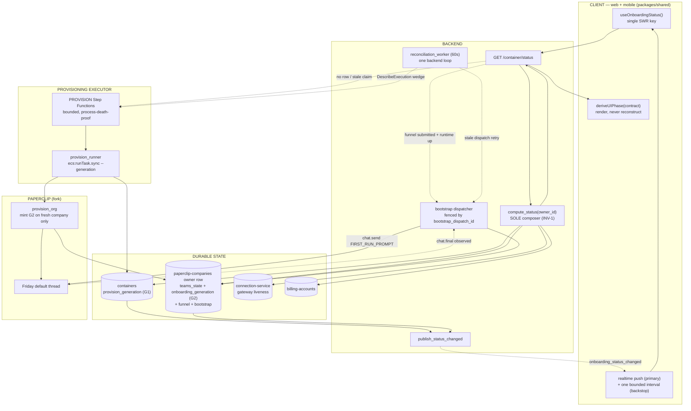

# Onboarding & Provisioning — Proposed Architecture

**Issue:** #1406 (P0 RFC). Determines #1407 (provisioning executor), #1408 (client sync), #1409 (Paperclip contract).
**Date:** 2026-07-24
**Status:** PROPOSED — awaiting owner review. **No implementation until approved.**
**Current-state companion:** `docs/superpowers/research/2026-07-24-onboarding-current-state.md`
**Method:** 3 independent design candidates (different stances) → 3-lens Opus judge panel → Opus synthesis. Judges split C > B > A (correctness lens), A > C > B (simplicity lens), C > B > A (robustness lens).

> **Hard constraints (owner-set, non-negotiable):** (1) **No users** → no migration/backfill machinery; target the end-state directly, wipe-and-reprovision is the "migration." (2) **No feature flags / dark-ship gating** → merged code is active on merge; validation is test-and-iterate in dev; rollback is `git revert`. (3) **We own both forks** (`Isol8AI/paperclip`, `Isol8AI/agent`) → prefer fixing a root in the fork over compensating in isol8.

---

## 1. Recommendation: "One Composer, Two Generations"

A **Contract-First backbone** (design C) fenced by **two independently-scoped generation ids** (design B's key idea), delivered with design A's **in-process bootstrap dispatcher**, the **F1 stop-first fix**, and **single-mint discipline**.

Three moves, in one sentence each:

1. **One composer.** `compute_status(owner_id)` becomes the *sole* reader of the five readiness inputs and emits one `StatusContract` that web and mobile **render, never reconstruct**. This kills the current-state disease directly — "readiness is composed per-request from five stores, and onboarding truth is duplicated across four more."
2. **Two generations.** A **container-scoped `provision_generation`** fences runtime/execution facts; a **company-scoped `onboarding_generation`** fences onboarding facts (funnel + bootstrap). Splitting them makes L1/L5/L6 die *by construction* — a container-only recreation cannot invalidate onboarding truth — and is exactly what makes the F1 fix safe.
3. **Server-owned bootstrap.** Friday's first-run kickoff becomes a backend-dispatched, idempotent, generation-fenced operation whose completion is the *observed* `chat.final` — not a Clerk latch, not thread-emptiness inference.

### Why this backbone

C won 2 of 3 judge lenses because it is the only candidate that answers the actual disease head-on (one composer, one contract) and uniquely kills readiness store **R4** — the in-process gateway-pool phase, a per-backend-instance non-durable truth that A and B both leave standing — by moving liveness onto the connection-service DDB table. C's one self-named weakness (its single `generation_id` had two bump triggers held together by convention) is fixed by grafting B's two-generation split, which every judge independently recommended. From A we take the F1 stop-first fix (the only candidate to fix an enumerated bug the others punt), single-mint discipline, and the honest Step-Functions cost/benefit that confines SFN to provisioning only. From B we take the "onboarding never gates chat" invariant and the precision that an org **seat** join is not a generation bump. We **reject** B's second (ONBOARD) state machine — it adds a task-token-staleness failure mode and a non-self-healing degraded forfeit, and B itself concedes it "may not strictly need SFN."

---

## 2. State model

**Two generation ids, each minted at exactly one code point; onboarding facts folded onto the `paperclip-companies` owner row (which isol8 owns in DynamoDB — no new table); Clerk demoted to a write-only presentation cache.**

> **Decision (2026-07-24, owner):** onboarding state lives on the existing `paperclip-companies` owner row, not a dedicated table. Two benefits: `compute_status` already reads that row (for `teams_state`), so this adds **zero** extra reads; and atomic-wipe gets simpler (onboarding dies with the company row). The cost — and the load-bearing requirement of the ONBOARD PR — is that the row's existing **whole-item `put` writers** (`provision_org`'s `repo.put`) must be converted to field-scoped / onboarding-preserving writes, or the co-located onboarding fields would be clobbered on reconcile (the very clobber a dedicated table would have dodged). This is mandatory, not optional.

### `containers` (PK `owner_id`) — add `provision_generation` (ULID)
The **container-incarnation fence**. Minted exactly once, inside `create_user_service`'s row-creating write (event **G1**, single mint point). **Preserved** by scale-from-zero, force-redeploy, restart, provider hot-swap, Bedrock revoke/restore, and Stripe conversion — those are the same runtime waking up. Threaded through the PROVISION executor as `--generation`; every provisioning DDB write is conditioned on it. Owns runtime/execution facts (status, substatus, lease) and **never** onboarding facts. **`onboarded_at` is retired** — this deletes S2 and the entire L1 restamp special-case.

### `paperclip-companies` owner row (PK `owner_id`) — add the onboarding fields
The **company-incarnation fence** lives on the row isol8 already owns. New attributes: `onboarding_generation` (ULID), `funnel_state` (`not_started|submitted|complete`), `funnel_submitted_at`, `funnel_completed_at`, `onboarding_goal_id`, `onboarding_project_id`, `bootstrap_state` (`not_started|dispatched|delivered|failed`), `bootstrap_dispatch_id` (fencing token), `bootstrap_dispatched_at`, `bootstrap_delivered_at`, `bootstrap_attempts`, `bootstrap_last_error`. (`company_id` and `friday_agent_id` already exist on this row.) DynamoDB is schemaless, so this is just new attributes — no CDK table to create.

`onboarding_generation` is minted **exactly once**, in `provision_org`'s fresh-create branch *after a genuinely-new Paperclip company is confirmed* (event **G2**) — **NOT** on reconcile-adopt of an existing `company_id`, and **NOT** on `provision_member` (an org seat). The mint atomically sets the new generation and resets `funnel_state=not_started` / `bootstrap_state=not_started` on the same write that records the fresh company. A container-only recreation (G1) never touches this row, so `funnel=complete` / `bootstrap=delivered` survive by construction.

**The load-bearing safety requirement:** onboarding fields are written via **generation-conditioned `UpdateItem`s** (a write against a superseded `onboarding_generation` is a silent no-op), AND the row's existing **whole-item `put` writers must be made onboarding-preserving** — `provision_org`'s reconcile-adopt / status-flip `repo.put` must not clobber the onboarding attributes (convert to a scoped `UpdateItem`, or read-merge the onboarding fields before the put). Without this, co-location reintroduces the clobber a dedicated table would have avoided. The funnel-claim (one-shot seed) that the `__onboarded__` sentinel provided is replaced by a conditional `funnel_state: not_started → submitted` write fenced on the generation — the loser gets `ConditionalCheckFailed` (already submitted), same guarantee, no separate sentinel item.

This replaces **S1** (Clerk `firstRun`), **S2** (`onboarded_at`), **S3** (`__onboarded__` sentinel), and **S4** (thread-emptiness inference — bootstrap completion is now the observed `chat.final`, recorded once).

### Clerk `unsafeMetadata` — demoted to a write-only presentation cache
The frontend *may* write `firstRun`/`getStarted` for an optimistic pre-first-poll paint, but **no backend code and no client gating logic reads it as authority** (enforced by a CI grep/architecture check). A forged or stale value produces at most a one-frame paint flicker, never a wrong gate. Justified by verification: Clerk `unsafeMetadata` is last-writer-wins (no conditional write) and user-forgeable by design.

### Readiness composition
`compute_status(owner_id)` in a new `core/services/readiness_state.py` is the **sole** reader of all five inputs — containers row, billing-accounts row, gateway liveness (moved **off** the in-process pool onto the connection-service DDB table, killing R4 and the PR #1364 self-heal dial), and the `paperclip-companies` owner row (which now carries both `teams_state` and the generation-fenced onboarding fields — one read, not two) — emitting one `StatusContract` (shared type in `packages/shared`) that both clients render via `deriveUIPhase`.

---

## 3. Proposed end-state

---

## 4. Invariants & ownership (each enforced in exactly one place)

| # | Invariant | Owner | Enforced where |
|---|-----------|-------|----------------|
| INV-1 | `compute_status(owner_id)` is the sole composer of readiness+onboarding truth; no router/hook/gate re-derives it | `readiness_state.py` | startup assertion + import-linter test (no module imports >1 of the 5 input stores) |
| INV-2 | `provision_generation` minted exactly once at G1; preserved by restart/redeploy/hot-swap/conversion | `create_user_service` | single mint point + integration test (restart doesn't change it, fresh service does) |
| INV-3 | `onboarding_generation` minted exactly once at G2 (fresh company only); not on reconcile-adopt, not on seat-join | `provision_org` | integration test: container-only recreation + seat-join non-bump |
| INV-4 | Every onboarding fact is generation-scoped; superseded reads absent/fresh, superseded writes are no-ops | `paperclip_repo` (paperclip-companies row) | generation-conditioned `UpdateItem` (`ConditionalCheckFailed` = superseded); existing whole-item puts made onboarding-preserving |
| INV-5 | Bootstrap kickoff dispatched at most once per `onboarding_generation`, server-side, no browser tab required | bootstrap dispatcher | conditional `pending→dispatched` write; only the claimer sends |
| INV-6 | Onboarding status never gates chat; chat availability is decided solely by runtime phase | `compute_status`/gate | integration test: a degraded/awaiting_brief status still yields a live chat surface |
| INV-7 | Clerk `unsafeMetadata` is a write-only presentation cache; no `core/` or gating hook reads it as authority | frontend/backend boundary | CI grep gate (no `firstRun` read in `core/` or in any status-contract hook) |
| INV-8 | The PROVISION executor guarantees bounded time-to-terminal-state independent of FastAPI liveness | PROVISION Step Functions | SFN timeout/failed alarms + unit/ASL assertions; validated by turning it on in real dev |
| INV-9 | Every backend async op that can outlive a request is claim/generation-fenced and recovered by exactly one sweep worker | `reconciliation_worker.py` | integration test: kill mid-provision and mid-bootstrap; next worker tick resolves both |
| INV-10 | A full wipe deletes container row + Paperclip company (Aurora) + the `paperclip-companies` owner row (onboarding rides with it) atomically; partial recreation refused | atomic-wipe endpoint | integration test: no orphan remains |
| INV-11 | Exactly one autoprovision trigger family, all keyed on `owner_id` | `ensure_user_ready` | integration test: proxy path routes through the canonical trigger |
| INV-12 | A Paperclip behavior isol8 depends on lives in fork source where cheaper than compensating; a compensation stays only while its fork gap is open | fork + #1409 | FORK-1/FORK-2 gate the compensation-deletion PRs |

---

## 5. Failure-mode handling

| Bug/Mode | Handling |
|---|---|
| **L1** funnel loop | Structural — `onboarded_at` retired; `funnel_state` lives on the G2-fenced row a container-only recreation never touches. **Dies by construction.** |
| **L2** upsert drops facts | SFN becomes the sole writer of the running/error transition (no dead-reckoning branch to divert into); containers writes become field-scoped generation-conditioned `UpdateItem`s (no whole-item put); the swallowed `describe_services` error (`ecs_manager.py:1751-1753`) is surfaced/classified. |
| **L3** org departure | Own-side defense: `and existing.org_id == owner_id` at `paperclip_provisioning.py:306`; FORK-2 + atomic-wipe remove the orphan-timer-drop residual. (Cross-tenant deletion already fenced by Paperclip authz per verification.) |
| **L4** mobile never re-onboards | Structural — `useOnboardingStatus`+`deriveUIPhase` live in `packages/shared`, the only legal path to the contract; no separate mobile latch to fall behind. **Dies by construction.** |
| **L5** cross-cycle kickoff | Server-owned dispatch, single-fire per `onboarding_generation`; completion observed from backend's own `chat.final`, not Clerk/thread-emptiness. G2 fencing means a container-only recreation doesn't re-arm it. |
| **L6** personal→org orphaning | Conversion mints a new `onboarding_generation`; the old row goes **inert** (keyed by the no-longer-live personal `owner_id`) rather than corrupting. Full orphan cleanup is a follow-up (open question). Corruption→inertness is the load-bearing win. |
| **L7** burned email | FORK-2 hard user-delete/reset; atomic-wipe deletes the Better-Auth user so re-signup succeeds. Post-FORK-2, the 422-terminal special case, adopt-via-signin, and `recover_orphan_paperclip_member.py` are deleted. |
| **F1** cold provider change | `change_provider` cold path calls `reprovision_for_user` (stop→drain→`background_provision`). Committed probe `test_change_provider_cold_running_container.py` flips red→green (merge gate). Safe under two generations: bumps `provision_generation`, preserves `onboarding_generation` → owner not re-onboarded. |
| **Backend dies mid-provision / Fargate death** | PROVISION Step Functions survives process death natively (bounded per-attempt + total timeout; self-resuming retries with a per-retry attempt token; `StopTask` double-tap before each retry fences stragglers). Boot-reconciler + stale-lease self-heal deleted. Zero client poll needed. |
| **Backend dies mid-bootstrap / slow provision forfeits kickoff** | The one `reconciliation_worker` (60s) retries a dispatched-but-undelivered bootstrap (bounded attempts) via `bootstrap_dispatch_id` fencing. If the runtime isn't up at brief-submit, dispatch waits for the next lifecycle→onboarding transition rather than storing a stale handoff token. |
| **SFN Branch-B wedge / same-claim straggler** | Fresh attempt token per SFN retry with a stable execution name (Branch-A idempotency intact); the sweep worker uses `DescribeExecution` to disambiguate still-running from closed-without-terminal-write (vs the current 300s wall-clock heuristic). |

---

## 6. PR sequence (active-on-merge; each independently shippable + observable in dev)

Ordered so no PR depends on a later one. Rollback is `git revert`. The fork PRs (1–2) flow through the `paperclip-version.json` dev→prod pin pipeline.

| # | PR | Fixes | Deletes |
|---|-----|-------|---------|
| 1 | **FORK-1** Paperclip honors `Idempotency-Key` on company/agent create | (enables) | reconcile-adopt, Atlas-skip, 409-as-success (later) |
| 2 | **FORK-2** Paperclip hard user-delete/reset endpoint | (enables L7) | adopt-via-signin, 422-terminal, `recover_orphan…`, raw Aurora DELETE (later) |
| 3 | Two generation ids (additive, inert — no consumer reads yet) | — | — |
| 4 | onboarding fields on `paperclip-companies` row + G2 + writer-safety (convert whole-item puts) + atomic wipe | **L1** | `onboarded_at` (S2), `__onboarded__` sentinel (S3), old debug DELETE doors |
| 5 | `compute_status()` composer + `StatusContract` + liveness→DDB | **L4** | PR #1364 self-heal dial, R4, stepper `useMemo` ladder + forked mobile classifier |
| 6 | Server-owned bootstrap dispatch + client cutover (**one atomic PR**) | **L5** | `useFirstRunKickoff` (both), Clerk `started/completed` writers, #1391 reconcile, BOOTSTRAP.md seeding |
| 7 | Realtime invalidation + `config.changed` + severed `health` event | — (latency) | — |
| 8 | Generalized `reconciliation_worker` (60s) | — | boot provisioning-resume reconciler, `maybe_resume_stuck_conversion`, standalone trial-idle sweep |
| 9 | Client: one hook + one bounded loop | (L4 mobile) | stepper 3s poll/focus/1s watchdog, `useSystemHealth` poll, focus opt-in, wake/unpark mutate trio, flash-bridge refs, mobile poll/classifier copy |
| 10 | **PROVISION Step Functions, live, no flag** (reshaped #1388) | **L2** | `_await_running_transition` detached loop, poll-driven auto-transition, stale-lease guard, boot-reconciler re-arm, superseded in-process locks |
| 11 | F1 stop-first provider change | **F1** | silent-refuse no-op path |
| 12 | One trigger family + L3 defense | **L3** | second autoprovision door (`paperclip_proxy.py:918-957`) |
| 13 | Paperclip fork adoption (post FORK-1/2) | **L7** | ~40–90 fork-gap compensations (verified against fork source before each deletion) |
| 14 | Coverage-proving cleanup + close #1388 branch | — | #1388 disable flag + its plan/spec docs; `runToastReducer` interrupted fix; adds `PAPERCLIP_SKIP_BUILTIN_AGENTS` CDK test + `roster_drift` metric + workspace-state round-trip CI check |

PR 6's atomicity is load-bearing: shipping the server dispatcher and the client cutover separately would leave a window where the client latch and the server dispatcher each win a claim.

---

## 7. PR #1388 disposition

**ADOPT, de-flagged, confined to provisioning only.** #1388's Step Functions core (RunProvisioner via `ecs:runTask.sync` with a foreground health-wait, Catch/Classify, native-DDB terminal writes, bounded retry) is the right shape for the *one* place a durable bound is load-bearing: the minutes-long, side-effecting provisioning path where the in-process asyncio executor cannot promise bounded time-to-terminal-state independent of FastAPI liveness (today's 6 stacked compensating layers). But — per design A's analysis every judge credited — **SFN fixes zero of L1–L7/F1 directly**; those are duplicated-truth/missing-identifier bugs fixed by the generation model, not the executor. So SFN is explicitly **not** the SSOT fix and is **not** extended to bootstrap (a sub-minute RPC with a natural `chat.final` completion signal; SFN there would be ceremony and add a task-token-staleness failure mode).

**Required reshape before merge (PR-10):** (1) remove `PROVISION_EXECUTOR` and the inline default entirely — no flag, no dual-run window (no-users makes same-PR activation safe); (2) close the PR's two open hazards *in this PR* — fresh per-retry attempt token with a stable execution name (fences stragglers, keeps Branch-A idempotency), and hand the Branch-B closed-without-terminal-write case to the `reconciliation_worker` via `DescribeExecution`; (3) pull the three synchronous doors (`/provision`, `/retry`, `/recover`) and the doors' supersede-deletion into the same wave so two provisioning systems are never live simultaneously; (4) thread `provision_generation` through the runner and condition every DDB write on it. **Validation:** unit tests + ASL/CDK assertions in CI, then turn it on in real dev and iterate — no LocalStack emulation, no dev-soak gate, no flag (owner decision 2026-07-24: "we're just turning it on").

**Decision (2026-07-24):** Step Functions adopted — the fallback (in-process only) is not taken. No LocalStack, no dev-soak gate, no flag; validation is CI unit/ASL assertions then turning it on in real dev.

---

## 8. Open questions (need owner input)

1. **L6 full cleanup:** the design makes the orphaned personal company *inert*, not deleted. Is inert-orphan acceptable at GA, or must conversion proactively delete/archive the old personal company/goal/Friday? (Follow-up PR, enabled by FORK-2 + atomic wipe.)
2. **Per-member org first-run:** onboarding lives on the paperclip-companies row keyed per owner (= `org_id` for orgs), and `provision_member` is deliberately not a bump. Does a newly-added org member need their own funnel/kickoff, or is org-level onboarding sufficient? (Current design assumes org-level.)
3. ~~LocalStack SFN emulation~~ — RESOLVED (owner, 2026-07-24): no LocalStack, no dev-soak gate. Step Functions is turned on in real dev and iterated on. Deleted as a concern.
4. **Server-initiated kickoff `chat.send`** is a telemetry assumption change — any client instrumentation assuming the client always initiates the first send needs a look before PR-6.
5. **Delivered-while-away kickoff UX** (user opens the app long after the backend delivered the kickoff) relies on `chat.history` refetch-on-mount — rated healthy by the sync research but not load-tested for this case; add a dev scenario before PR-6.
6. **`_purge_builtin_agents` removal** stays blocked on coverage that doesn't exist yet (no CDK test pinning `PAPERCLIP_SKIP_BUILTIN_AGENTS`, no `roster_drift` metric). PR-14 adds both; decision needed on whether to keep the belt-and-suspenders layer indefinitely or set a removal trigger once the metric exists.

---

## 9. How this composes the sibling issues

- **#1407 (provisioning executor):** answered by §7 — adopt #1388 de-flagged, confined to provisioning, with the two open hazards closed and `provision_generation` threaded. The 24-trigger funnel collapses to one `owner_id`-keyed family (INV-11); the 6 process-death layers are deleted (PR-10) in favor of SFN + the one sweep worker.
- **#1408 (client sync):** answered by §2/§3 — one `StatusContract`, one `useOnboardingStatus` hook, realtime-push primary + one bounded backstop loop (PR-5/7/9). Deletes the 12-mechanism `/container/status` stack, the dead `useGatewayRpc` revalidation (re-wired), and the byte-forked mobile classifier. The staleness/ownership matrix from the #1408 research becomes the contract skeleton.
- **#1409 (Paperclip contract):** answered by INV-12 + PRs 1/2/13 — the two fork-fixable roots (Idempotency-Key, user-delete) collapse ~40–90 compensations; each deletion is verified against pinned fork source (`2fdafe83`) before removal. `_purge_builtin_agents` stays until coverage exists (open question 6).
