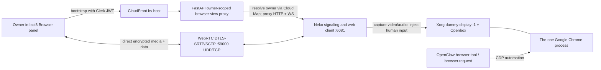

# Browser WebRTC Design

**Date:** 2026-08-20

**Status:** Approved for implementation

**Owner:** Isol8
**Related plan:** `docs/superpowers/plans/2026-08-20-browser-webrtc.md`

## Summary

Replace the Browser workspace panel's visual transport with a full-display WebRTC session. The stream shows the real Chrome window, including its native tabs, omnibox, dialogs, and popups; carries browser audio; and accepts keyboard, mouse, touch, and clipboard input.

OpenClaw remains the browser authority. Its browser tool and `browser.request` RPC continue to own Chrome lifecycle, tabs, navigation, and CDP automation. Isol8 adds only the human-facing display/input transport and the owner-scoped route that surfaces it. There is one Chrome process and one browser state.

The implementation uses [Neko](https://github.com/m1k1o/neko) v3.1.5 as the WebRTC/X11 substrate. Isol8 builds the Neko server from immutable commit `395ca1a6f62b7b0e270e654d366a2d57b8042efd` against the existing Debian base and copies the matching web client from `ghcr.io/m1k1o/neko/base@sha256:20806497c78de64700cb7befa674dbdc6bc4e8f0848a3dc911f0878a6726fa36`. We do not fork its browser lifecycle or use its bundled Chrome image.

## Goals

- Make the Browser panel feel like a native, continuous browser surface rather than a screenshot feed or a React recreation of browser chrome.
- Show the complete display: native Chrome tabs and omnibox, OAuth windows, dialogs, CAPTCHAs, downloads, and other browser UI.
- Support browser audio and smooth video playback without starving Chrome, OpenClaw, or chat on the existing 1 vCPU / 4 GB owner task.
- Preserve OpenClaw browser-tool behavior and the existing tool-event auto-open integration.
- Authenticate and resolve every signaling/static request to the current Clerk owner; never accept a client-supplied owner or container address.
- Recover cleanly from panel close/reopen, task replacement, trial wake, network changes, and short browser starts.
- End with WebRTC as the only human visual transport. VNC and CDP screencast remain only as temporary rollout fallbacks and are deleted after acceptance.

## Non-goals

- Gaming-grade latency, 60 fps, 1080p, simulcast, or multiple quality ladders.
- Reimplementing OpenClaw tabs, navigation, browser lifecycle, or CDP commands in Isol8.
- Microphone/webcam forwarding into the remote browser in this migration.
- Coordinated multi-viewer UX. Multiple authenticated clients for the same owner may view and control the one shared display; this migration adds no viewer, session, or peer limit, no arbitration, and no collaboration affordances.
- Solving website bot detection. Giving each task a public address may change egress reputation, but it is not an anti-detection promise.
- Persisting the raw Chrome profile on EFS. Existing browser-state snapshot/restore remains unchanged.
- Operating TURN before measurements show it is needed. The owner task is directly reachable over authenticated ICE on a unique public address; direct UDP plus ICE-TCP is the shortest reliable path for this topology.

## Authority boundary

| Concern | Sole owner | Notes |
|---|---|---|
| Chrome process and profile | OpenClaw | `browser.request POST /start` stays idempotent and authoritative. |
| Tabs, navigation, DOM, screenshots for the agent | OpenClaw browser tool/CDP | No duplicate tab registry or navigation API is introduced. |
| When the Browser panel opens | Existing Isol8 tool-event integration | `useBrowserToolAutoOpen` remains unchanged. |
| Human video/audio/input | Neko attached to the shared X display | Neko never launches or restarts Chrome. |
| Tenant auth and container selection | Isol8 FastAPI backend | Owner derives only from the validated Clerk token. |
| Media encryption and transport | WebRTC (DTLS-SRTP/SCTP) | Media bypasses FastAPI/CloudFront after signaling. |

## Chosen architecture

### Why Neko

Neko already provides the narrow capabilities this project needs: X11 capture, GStreamer WebRTC encoding, PulseAudio/Opus, Pion signaling, XTEST input, clipboard synchronization, reconnection, and a video-only embed mode. It attaches to an existing display, so it does not compete with OpenClaw for browser ownership.

The server is built from the pinned source commit in a dedicated Debian Bookworm Go 1.25 builder stage. This keeps its glibc baseline compatible with the OpenClaw runtime and avoids changing the existing skill-builder toolchain. Matching static client assets come from the pinned multi-architecture Neko base-image digest.

Alternatives were rejected:

- CDP `Page.startScreencast` captures only page content, has no browser audio, and requires Isol8 to recreate tabs and browser chrome.
- VNC shows the full display but is a poor media transport and has no first-class browser audio.
- Selkies' documented next-generation path is ahead of its stable release line and currently has a less dependable maintenance/release posture.
- A custom WebRTC server would recreate capture, codecs, signaling, input, clipboard, and reconnect logic already present in Neko.

### Display and window management

The final display stack is:

1. Xorg with Debian's dummy video driver on `DISPLAY=:1`.
2. Openbox using Neko's browser rule: the main Chrome browser is maximized and undecorated, while dialogs and popup windows remain focusable and usable.
3. PulseAudio with one virtual output sink; Chrome writes to it and Neko captures its monitor source.
4. Neko attached to `DISPLAY=:1` and the PulseAudio socket.
5. OpenClaw launches the existing `/usr/bin/google-chrome` against that display when `browser.request /start` first runs.

Xorg is eager because OpenClaw decides headless/headful once at Chrome launch. Video/audio encoding is lazy because Neko starts capture pipelines only while a viewer is watching.

### Stream profile

The initial production profile is intentionally one conservative VP8 pipeline:

- display refresh: 24 Hz;
- stream frame rate: 24 fps, reduced to 20 fps if the dev CPU gate fails;
- maximum rendered area: 1,024,000 CSS pixels, with no device-pixel-ratio multiplication;
- default display: 1280 x 800;
- target bitrate: 1.8 Mbps CBR;
- Opus browser audio;
- one encoder thread and a realtime/high-`cpu-used` VP8 preset;
- screencast fallback disabled.

The panel observes its CSS size, rounds dimensions to encoder-friendly multiples, clamps the pixel area, and posts the resulting resolution to Neko's supported `POST /api/room/screen` endpoint after a 300 ms debounce. It does not resize for changes smaller than one rounded step.

There is no 60 fps mode, resolution ladder, bandwidth estimator, or simulcast. Those add CPU and state before there is evidence they improve this single-viewer product.

### Networking

Each owner task moves from private subnets with a shared NAT egress address to public subnets with `assignPublicIp: ENABLED`. The task security group continues to deny all unsolicited traffic except:

- TCP from the backend service security group to internal app ports, including Neko `:6081`;
- TCP and UDP `:59000` from the internet for Neko's single ICE mux port;
- existing EFS and outbound rules.

Neko uses ICE Lite, trickle ICE, UDP mux `59000`, TCP mux `59000`, and its task public IP as the 1:1 candidate. Signaling and the ICE username/password are available only after owner authentication. DTLS-SRTP encrypts media and SCTP data-channel input.

Direct public candidates are appropriate here because every owner already has a dedicated Fargate ENI and browser task. They avoid a shared UDP router, avoid a permanent relay bill, and avoid giving a third-party TURN credential lifecycle control over session smoothness.

TURN is a measured fallback, not a hidden requirement. After the dev and limited-prod rollout, if connection success is below 99.5% or a meaningful supported network class cannot connect over UDP or ICE-TCP, add managed/self-hosted TURN in a separate evidence-backed design. Do not ship reusable public TURN credentials or couple this migration to five-minute Kinesis Video Streams TURN credentials.

### Backend auth and proxy

The existing `bv[-env].isol8.co` CloudFront -> private ALB `:8081` door remains. Its cache-disabled/all-viewer behavior already supports cookies and WebSocket upgrades, and the ALB listener already caps access to `/api/v1/browser-view/*`.

The backend browser-view router gains three responsibilities:

1. `POST /api/v1/browser-view/session`
   - receives a current Clerk token in `Authorization`;
   - validates it with the normal Clerk verifier;
   - derives the owner with `resolve_owner_id`;
   - resolves the current container IP through Cloud Map with no caching;
   - sets a short-lived HttpOnly `Secure` browser-view auth cookie containing that already-short-lived Clerk token;
   - reuses a valid Neko session cookie or logs into the container-local Neko no-auth provider server-side as a constant `owner` user;
   - forwards Neko's HttpOnly session cookie to the browser;
   - returns the iframe URL and current session state.

2. `/api/v1/browser-view/webrtc/{path:path}` HTTP proxy
   - validates the browser-view cookie on every request;
   - resolves the current owner container per request;
   - rejects normalized `/api/room/broadcast` and every descendant before any upstream request;
   - forwards only the Neko path prefix to `http://<private-ip>:6081`;
   - strips hop-by-hop headers and the Isol8 auth cookie before forwarding;
   - streams bodies and preserves content type, cache control, and Neko session-cookie updates.

3. `/api/v1/browser-view/webrtc/ws` WebSocket proxy
   - validates the browser-view cookie before `accept()`;
   - resolves the current owner container per connection;
   - forwards only the Neko session cookie upstream;
   - closes both legs as soon as either leg ends.

Neko uses its `noauth` provider only because the backend/SG combination is the real tenant fence: `:6081` is reachable only from the backend service SG, the client never receives a container IP, and the public media mux cannot create a peer without signaling's random ICE credentials. There is no client-controlled owner id. The constant `owner` Neko identity names the shared display; it does not limit active sessions or peers. Every client independently crosses the verified-Clerk owner bootstrap and per-request browser-view cookie boundary before it can receive its Neko session cookie or use the proxy. Concurrent same-owner viewers/controllers are allowed technically, but their input races and shared display are unsupported product behavior.

The parent panel refreshes the short-lived browser-view auth cookie every 45 seconds while mounted. A refresh failure does not tear down an established WebRTC session; it changes the panel to reconnecting only when signaling itself needs to reconnect.

### Frontend experience

`BrowserDockPanel` remains the registered singleton panel and continues to call `browser.request POST /start` whenever it opens or retries. The VNC client is replaced by a full-size iframe pointing to Neko's video-only `cast=1` view after the authenticated session bootstrap succeeds.

The visible behavior is:

- existing panel opens automatically on OpenClaw browser tool start;
- one quiet loading state while the container/Chrome/WebRTC session starts;
- the real Chrome UI fills the available panel with no Isol8-generated address bar or fake tabs;
- native Chrome tabs and popup/dialog behavior replace the CDP-polled tab overlay;
- video starts muted when required by browser autoplay policy; Neko's centered click-to-play/unmute overlay is preserved;
- iframe permissions allow autoplay and explicitly delegated clipboard access;
- the parent polls Neko's authenticated `api/whoami` only during startup and removes the Isol8 loading veil when `state.is_watching` becomes true;
- a 300 ms debounced panel resize updates the remote X display within the pixel cap;
- a failed bootstrap or iframe load shows one actionable Retry state;
- panel remount and task replacement obtain a fresh container IP and Neko session; no IP is cached.

Neko's third-party header, room list, chat, and admin chrome are hidden by `cast=1`. Isol8 does not fork or restyle its client in this migration.

### Coexistence with agent automation

Human input and agent CDP commands may target the same Chrome concurrently, exactly as they can with the current VNC view. The transport does not add a lock or pause the agent. Adding arbitration without a real conflict signal would create a second browser state machine and is outside this migration.

The following existing behavior is intentionally preserved:

- `useBrowserToolAutoOpen` listens to normalized OpenClaw `browser` tool starts;
- `browser.request /start` is the idempotent manual-open path;
- browser cookies/localStorage snapshot and restore remain backend-to-OpenClaw RPCs;
- OpenClaw owns tab selection and browser state even though the human can click native tabs.

## Failure handling

| Failure | User behavior | System behavior |
|---|---|---|
| Container asleep or provisioning | Loading, then Retry if bounded bootstrap expires | Session endpoint returns distinct 503; no background wake-spam loop. |
| Chrome cold start | Display appears first, then Chrome draws | `/start` stays fire-and-forget and idempotent. |
| Neko unavailable | Retry state | Chat and agent container remain healthy; browser display is auxiliary. |
| Signaling/WebRTC disconnect | Neko reconnect UI, then panel Retry if remount is required | Fresh bootstrap resolves the new task IP. |
| Auth refresh fails | Existing media continues until it needs signaling | Next refresh/reconnect obtains a fresh Clerk token. |
| Resize rejected | Existing resolution remains visible and scaled | Last known good size is retained; no retry loop. |
| Audio autoplay blocked | Video plays muted with one click-to-unmute affordance | No repeated `play()` calls or custom audio state machine. |

## Security

- Owner identity comes only from a verified Clerk token and org claims.
- Container IPs, Neko ports, cookies, and ICE credentials are never accepted from client parameters.
- The Isol8 auth cookie and the forwarded Neko session cookie are host-only, HttpOnly, `SameSite=Strict`, short-lived, path-scoped to `/api/v1/browser-view`, and `Secure` outside localhost; neither is forwarded upstream except the Neko cookie to the resolved owner's Neko process. `SameSite=Strict` permits the `https://[bv-]isol8.co` iframe under the same-site `https://[dev.]isol8.co` parent while withholding both cookies on cross-site requests.
- `POST /session` accepts the Clerk `Authorization` token and CORS only from the exact Isol8 frontend origins. Every cookie-authenticated unsafe HTTP method and WebSocket upgrade validates an exact `Origin`: the matching Isol8 frontend origin for parent bootstrap, or the matching `bv[-env].isol8.co` origin for Neko's same-origin iframe client. Missing or other origins are rejected before proxying. Safe reads remain cookie-authenticated. This is the CSRF defense; frame ancestry is only embedding policy.
- Proxy paths are fixed under Neko's configured prefix; no arbitrary upstream URL or port exists.
- Hop-by-hop headers and client-supplied forwarding headers are dropped.
- Neko `pprof`, metrics, webcam, microphone, upload-drop, and JPEG screencast features are disabled in production config. Pinned Neko cannot unregister broadcast routes: the private runtime leaves its URL empty and autostart false, while the backend rejects normalized `/api/room/broadcast` and descendants before proxying; the Task 4 negative test proves no upstream call.
- Public ingress exposes only the ICE mux port. Neko HTTP/signaling remains private behind the backend SG.
- Browser-view responses use a narrow `frame-ancestors` policy for Isol8 app origins. The generic backend `X-Frame-Options: SAMEORIGIN` header is skipped only for this authenticated iframe path.

## Observability and acceptance gates

### Automated gates

- Docker image builds and `neko --version`/GStreamer/Pulse/Xorg smoke checks pass.
- CDK tests pin public owner subnets, `assignPublicIp: ENABLED`, and the exact TCP/UDP media ingress without widening other task ports.
- Backend tests prove missing/bad/expired auth rejects before proxying, org members resolve the org owner, both `Set-Cookie` values carry host-only/HttpOnly/SameSite/Path/Secure attributes, normalized broadcast paths and descendants reject with no upstream call, cross-site unsafe HTTP and WS origins reject before proxying while allowed frontend and `bv` origins work, the auth cookie is not forwarded upstream, arbitrary paths/hosts cannot proxy, and either WS leg ending tears down the other.
- Frontend tests prove URL mapping, bootstrap-before-iframe ordering, bounded/debounced sizing, `/start` behavior, retry, and removal of noVNC/CDP-tab polling.
- Existing backend, frontend, infra, and E2E tests pass.

### Dev manual gates

Run on a real dev Fargate owner task for at least 30 minutes:

- Google home/static text is crisp at normal panel sizes.
- YouTube video and audio play continuously with no recurring stalls or A/V drift.
- Main Chrome UI, native tabs, omnibox, right-click menus, downloads, OAuth popup, CAPTCHA/2FA input, clipboard, scrolling, keyboard modifiers, and touch input work.
- Repeated panel close/open, dock resize, browser restart, task redeploy, and network switch reconnect without a stale task IP.
- Safari, Chrome, and the Tauri desktop shell can establish the session; mobile remains out of scope unless the Browser panel is exposed there.
- No cross-owner request reaches another container in explicit negative testing.

### Resource gates

During the same run, use ECS Exec (already enabled for owner tasks) to capture `top -b -d 10 -n 61` from the owner container for each separate ten-minute static and motion/video segment. For each of the 60 timed frames, sum `%CPU` for `neko`, `Xorg`, `openbox`, and `pulseaudio`; that named process set is the display-stack sample. A process restart or missing frame invalidates the segment and requires a rerun. In parallel, query the existing AWS/ECS service `CPUUtilization` and `MemoryUtilization` metrics at one-minute resolution for the same ten timestamps; Container Insights is not used.

- static page: the 60-frame display-stack average is at most 25% of one vCPU;
- motion/video: the 60-frame display-stack average is at most 45% of one vCPU, and every matching one-minute task CPU sample is below 80%;
- every matching one-minute task-memory sample is below 80% of the 4 GB reservation (3.2 GB);
- connection establishment succeeds in at least 99.5% of measured supported-client attempts;
- no OpenClaw browser RPC timeout, gateway health failure, or chat-stream regression is attributable to capture.

If the CPU gate fails, tune in this fixed order: reduce frame rate from 24 to 20, then reduce the maximum pixel area from 1,024,000 to 576,000 (960 x 600). Do not increase task CPU, add a quality ladder, or change codecs until both steps are measured.

## Rollout and rollback

1. Ship the Neko runtime and config while the frontend still selects VNC. Encoding stays idle without a viewer.
2. Ship public owner-task networking, backend proxy, and the WebRTC panel behind a temporary frontend transport flag whose default remains VNC.
3. Enable WebRTC in dev only; run automated, manual, and resource gates.
4. Enable for a limited production cohort, observe connection success and task resource metrics, then make WebRTC the production default.
5. Keep the VNC flag for one production observation window. Rollback is a frontend flag flip; OpenClaw and Chrome state are unchanged.
6. Delete the flag, VNC relay/client/packages, CDP screencast relay/panel/input code, websockify/Xvnc/x11vnc/Xvfb/socat visual processes, and their tests. Keep only Xorg/Openbox/Pulse/Neko and OpenClaw CDP automation.
7. Delete this spec and its implementation plan after the final cleanup PR merges, per repository policy; the PR descriptions and git history become the durable record.

## Estimated sequence

This is expected to take four to six weeks of implementation, dev validation, and staged rollout, with two additional weeks reserved for codec/resource tuning and production observation. The system can stop safely after any rollout phase because VNC remains the selected fallback until the WebRTC gates pass. The migration is not complete until the final transport cleanup lands.
