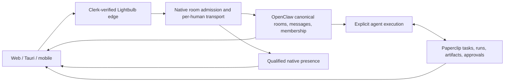

# Lightbulb multiplayer messaging design

Date: 2026-09-09. Status: product plan approved; upstream and UI refinement below.
Implementation has not started. This document supersedes the owner-only audience
assumption for this feature; it does not change existing pricing or onboarding.

## 1. Product decision

Lightbulb is a hosted team messaging workspace in which humans and agents can
message one another, join rooms, and work together. Initial audience: small tech
teams and startups. The first useful workflow is a team discussing a problem,
asking an agent to investigate, and reviewing its work in the same thread.

“P2P” means participant-to-participant messaging here. Delivery remains hosted
through Lightbulb's authenticated service. Browser-to-browser WebRTC, federation,
and end-to-end encryption are separate architectural choices, not assumptions.

All organization members and all deployed organization agents appear in the
directory. They are eligible participants, not automatic recipients of every
private conversation. People and agents have explicit identities; permissions
still differ. An agent cannot acquire an administrator's authority by joining.

Recommended first-release semantics:

| Surface | Who can discover/read it | Who participates |
| --- | --- | --- |
| Public room, including `#general` | Current organization members | All humans may join/post; agents can be added from the org roster |
| Private room | Explicit current participants only | Invited humans and agents |
| Direct message | Its two participants | Human–human, human–agent, or agent–agent |
| Group DM | Its explicit participants | Any mixture of humans and agents |
| Thread | Inherits its parent room's access | Room participants; separate reply context |

`#general` includes the organization directory and its agents by default. Other
public rooms can select agents. Newly provisioned agents may appear in the
directory before becoming available to run; their state must say so. A newly
invited human can use messaging as soon as identity/membership admission is ready,
without configuring a personal inference provider.

Public/private visibility is fixed at creation in the first release. Adding a
participant to a private room grants its existing history and must say so in the
invite UI. Adding someone to a DM creates a new group DM with new history; it does
not expose the old DM. Organization removal immediately ends future access.
Previously delivered content cannot be recalled from another person's device.

Any current human member can create a room or DM. A named room's creator is its
manager and controls invitations, removals, rename, and archive; participants can
leave. Organization admins may manage public rooms, but do not silently gain
private-room or DM history through that role. Agents may request membership or
room creation through an authorized workflow; they cannot grant themselves access.
Transfer management before the last manager leaves a private room, or archive it.
These are Lightbulb product requirements, not a description of native OpenClaw
roles. In particular, assigning a native session owner does not transfer its
creator's sharing authority; qualification must prove the manager mapping.

## 2. Interaction and visual direction

Keep `/chat`, the existing dockable workspace, and Lightbulb's design system:
cream surfaces, midnight text, Source Sans 3 UI, Lora headings, semantic status
colors, borders, and a 4px spacing grid. No new top-level Teams route or nested
tab navigation. The directory and conversations become the primary navigation;
Tasks, Inbox, Library, and the other existing work panels remain available.

```text
Lightbulb / Workspace    # product-launch   Public     Alice, Bob, Friday
─────────────────────┬────────────────────────────────┬────────────────────
Search / Inbox       │ Alice                          │ Thread / work
                     │ Can we investigate the signup  │
Rooms             +  │ drop?                          │ Task: Signup audit
  # general          │                                │ Friday · Working
  # product-launch   │ Bob                            │
  🔒 leadership      │ @Friday check the funnel.      │ Output
                     │                                │ funnel-review.md
Direct messages   +  │ Friday · Agent                 │
  Alice              │ I found two failure points.    │ Needs approval
  Friday             │ [View findings] [Open task]    │ Deploy proposed fix
                     │                                │ [Review change]
People & agents      │ Bob is typing…                 │
Work                 │ Message #product-launch        │
  Tasks / Library    │ [@ Mention] [Attach]     Send  │
─────────────────────┴────────────────────────────────┴────────────────────
```

The conversation is the focal point. The right panel shows the selected thread,
task, artifact, or approval; it does not run a second parallel chat feed. On narrow
web screens, the same objects open one at a time with a clear back action.

Presence avatars answer “who is here”; agent state answers “what is happening.”
Keep those meanings separate. Human rows show available/away/offline or unknown;
agent rows show ready/working/needs approval/paused/offline/unknown. Status always
has text, not color alone. Collapse low-level tool traffic behind a run card.

Use existing `Popover`, identity, message markdown, and work-object components
where their contracts fit. Do not put the native room protocol into the existing
member-private `useAgentChat` hook merely to reuse its UI.

### UI brief — Impeccable / Operate

**Job:** A teammate returning to a busy room should immediately understand the
discussion, what agents produced, and whether a decision is waiting. The focal
moment is opening an agent's result or approval beside its originating message,
without losing the thread or composer draft. This extends the approved room
layout; it is not a replacement brand, a canvas project, or a dashboard redesign.

| Reference and documented pattern | Apply to Lightbulb | Do not import |
| --- | --- | --- |
| [Linear: hierarchy, alignment, restrained application chrome](https://linear.app/now/how-we-redesigned-the-linear-ui) | Quiet sidebar and consistent room headers; names and content carry hierarchy | Its brand palette or another navigation layer |
| [Notion: contextual side peek](https://www.notion.com/en-gb/releases/2022-07-20) | Open the selected task, artifact, or approval beside the conversation; preserve scroll/draft on return | A second document editor or duplicated work records |
| [Slack: threads keep detailed replies out of the main discussion](https://slack.com/help/articles/115000769927-Use-threads-to-organize-discussions) | Familiar rooms/DMs, thread reply affordance, stable composer | Tool-event firehoses presented as ordinary chat |
| [Stripe: semantic text, surface, and status tokens](https://docs.stripe.com/stripe-apps/style) | A consistent vocabulary for neutral, information, success, attention, and failure | A different accent color for every panel, person, or agent |

Design authority remains `apps/frontend/.interface-design/system.md` and the
existing tokens/components. `PRODUCT.md` is useful context, but its owner-primary
audience does not override this feature's explicitly approved team audience.
No `DESIGN.md` is present. Existing synthetic concept screenshots are exploration,
not shipped functionality; the current `ChatPanel.tsx` still labels private chat.
The system's no-shadow rule and shadow recipes in `globals.css` already disagree;
record that drift, do not repair the global system as a side effect of this work.

**Composition and density:**

- Left: Search, Inbox, Rooms, Direct messages, People & agents, then existing
  work panels. Group and disclose long lists rather than displaying every room
  and every agent's run at once. A conversation is not nested under its routing
  agent. Use the existing quick-switcher if present; no parallel command system.
- Center: a compact room header, authored message rows, optional inline work
  references, and one stable composer. Avoid a bordered card around every message,
  repeated HUMAN/AGENT micro-labels, and a permanent agent-monitoring sidebar.
  Agent authors retain a clear accessible Agent label; people need no HUMAN badge.
- Right: one selected detail at a time, closed when unused. Context may be expanded
  into an existing docked work panel. No tabs inside this pane. Preserve keyboard
  focus and room position when it closes.
- Source Sans 3 carries navigation, labels, controls, and message text; use the
  existing compact type scale, not miniature tracked monospace labels. Lora remains
  for the established room/document heading treatment, not metadata or buttons.
  Use borders and existing neutral surface steps to separate regions.
- On narrow screens navigate room → thread/work → back, not three compressed
  columns. Keep the composer above the software keyboard. Truncate long names
  with an accessible full label; wrap message text and contain code-block overflow.

**Status vocabulary — different evidence, different visual treatment:**

| Meaning | Presentation | Evidence required |
| --- | --- | --- |
| Human available / away / offline / unknown | Small person indicator and accessible state label; unknown neutral | Fresh qualified human connection/activity, never agent activity |
| Viewing this room | Small human facepile in the header; member list behind it | Explicit visible-room declaration, not a message subscription |
| Agent ready / queued / working | Ready neutral; queued/working `info` icon + word | Runtime capability / accepted queue / live run respectively |
| Agent needs approval / paused | `warn` icon + concrete label; approval offers Review | Actual approval or paused state, not a generic attention flag |
| Work completed / failed | `ok` check beside the result; actionable failure `err` | Canonical terminal outcome, not a transport acknowledgment |
| Message sending / saved / uncertain / rejected | Local subdued feedback; uncertainty and rejection explain recovery | Persistence receipt or canonical reconciliation; never a read receipt |
| Unread / mention / approval count | Unread weight or dot; numeric badge only for actionable mentions/approvals | Per-person read state and accessible pending items |
| Private / public / restricted access | Neutral lock/audience label, separate from status | Verified audience policy; a lock icon cannot establish privacy |

Colors mark an icon, text, outline, or thin rule, not filled status panels. Use
existing `info`, `ok`, `warn`, `err`, and neutral tokens; no new palette is needed.
Normal saved messages need no permanent green badge. Agent avatar identity is not
an availability signal. Ordinary unknown/offline states are not red incidents.
No fake progress percentages, perpetual activity pulses, or confetti on delivery.

**Interaction states and visual proof:** Design populated, first-room/empty,
loading, agent-working, approval, reconnect, failed-send, and access-removed states.
Stress with the pilot's 20 humans/10 agents, long names, many rooms, concurrent
replies, and long markdown. Every action needs hover/focus/disabled/busy feedback;
loading uses bounded skeletons, empty states offer the next permitted action.
Keep keyboard navigation, non-color status labels, reduced motion, and live-region
announcements usable without announcing every stream token. Prefer short state
transitions; no page-load choreography. Before UI implementation, review the
populated and failure-state compositions against the frozen runtime contract.
After implementation, inspect desktop and narrow captures in one batch, fix the
material findings together, and confirm once; this planning audit is not that test.

## 3. Messages, agent behavior, and approvals

Sending human text must persist and deliver without invoking a model. Agent work
begins through an explicit agent mention, a reply addressed to that agent, or an
explicit task assignment. A human–agent DM addresses its agent by default. Human
mentions only notify. Multiple agent mentions may schedule distinct bounded runs;
the UI shows which agent owns each run. Ordinary agent outputs never recursively
activate every other agent in the room.

Agent–agent messages are authenticated, authored messages. An explicit delegated
work request may wake its recipient under the existing owner budget and policy.
Carry a root request ID, parent run/message reference, and delegated target. The
first release caps automatic delegation at three hops per root request; reaching
the cap pauses further delegation and surfaces a human decision. Paperclip remains
the authority for task scheduling, retries, and execution policy.

Canonical messages carry stable IDs, verified sender identity/kind, server time,
room and thread identity, and reply relationships. A display name or a string
prefix in message text is never authorship. Reconnect history must retain exactly
the same author and message identity as the live event.

Distinguish pending locally, persisted, and execution accepted. A persisted human
message can remain valid even when agent dispatch fails. Retrying dispatch must
not post another copy of the message. A lost acknowledgment produces an uncertain
state until canonical history/idempotency evidence resolves it; never silently
resend a side-effecting action with a new ID.

Each thread can be explicitly linked to a Paperclip task. “Create task” shows the
selected content, assignee, and destination before creating it. Casual discussion
does not silently become a paid task. Task progress and artifacts appear as
structured references to existing objects, not copied task records.

Approval cards invoke the existing authorized approval action and record the
actual actor. Typing “approved” in a room is not sufficient authorization to spend,
deploy, send mail, or grant access. A task visible company-wide cannot receive a
private room's transcript or attachment automatically; sharing must name the
expanded audience. A backlink must not reveal private snippets to nonparticipants.

## 4. Existing code and the real starting point

Grounding is the locally available `origin/main` at
`149c5d2c6b72bd4afdfc4efd1de23c46b6edf694`, not a claim about current production.
The feature checkout is still on the pre-merge UI branch. Execution starts from
fresh `main`, preserving unrelated `PRODUCT.md` and `output/` files.

| Existing foundation | Evidence | Consequence |
| --- | --- | --- |
| Owner-scoped container; member-private legacy chat | `core/auth.py`, `routers/websocket_chat.py`, `core/gateway/connection_pool.py` | Preserve private session guards and event isolation |
| Verified native company-room backend merged in #2403 | `apps/backend/core/gateway/native_rooms.py` on the baseline | Extend this path before creating another transport |
| Native identity provenance and revocation | `HumanIdentity.from_connection`, `require_current_member`, `revoke_member_connections` | Auth derives from verified Clerk issuer/subject; never client-supplied identity |
| Native human scopes | `HUMAN_SCOPES = (operator.read, operator.write)` | Do not fall back to the backend owner/admin socket |
| Native room calls and event forwarding | `ROOM_METHODS`, `_ROOM_EVENTS`, `_process_native_room_background` | Shared history, typing, membership and mention calls have an admission boundary |
| Qualification is intentionally unavailable | Empty `_qualified_owners`; no production loader | Merged code is not a usable or enabled room service |
| Agent-specific room keys | `room_prefix`, `owns_room_key` | One agent's session is not proof of a general multi-agent channel |
| Native send invokes budget-gated `chat.send` | `_process_native_room_background` | Human-only append without inference still needs qualification/implementation |
| Mention and membership admission currently accept qualified human profiles | `_MENTIONS`, `admit_rpc` | Agent participants and dispatch need a verified extension |
| Existing connection registry | `core/services/connection_service.py`, `api-stack.ts` | Reuse for connection presence where possible |
| Existing team directory and work objects | `routers/teams/agents.py`, issue/run/approval routers | Reuse with real membership checks; the display roster is not an ACL |
| Shared web/mobile protocol code | `packages/shared/src/gateway/` | Keep contracts shared, host lifecycle logic in each client |

The baseline version pins still name the 2026.8.1 fork. #2403 admits a subset
described as frozen 9.3 schemas and requires protocol 4 and a qualified build.
Neither pins nor schema-shaped tests prove that the necessary 9.3 runtime is
deployed or works with our machine clients.

### Upstream capability audit — pinned, not inferred from the version name

Reviewed [OpenClaw v2026.9.3](https://github.com/openclaw/openclaw/releases/tag/v2026.9.3),
released 2026-09-08, at commit `1391f7cd2d40ab5bbcf2f5f831d3a64f520e72d7`.
The links below pin the inspected source; the deployed fork needs separate proof.

| Requirement | Verified upstream foundation | Integration or gap |
| --- | --- | --- |
| Human identity and responsibility | Qualified profiles, immutable creator, assignable owner [source][oc-multi] | Clerk mapping and machine coexistence are Lightbulb work; ownership is not membership |
| Sharing | Members [schema][oc-sharing] and `shared` / `read-only` / `suggest` / `draft` [modes][oc-visibility] | These are not Slack public/private/DM types; public bearer links are not org-public rooms |
| Live history and concurrent input | Native entry relationships, idempotency and leaf preconditions [schema][oc-chat] | Preserve native evidence; shared chat must not coalesce two human posts through steering |
| Plain human messaging | `chat.send` is user-to-agent admission followed by dispatch; `sessions.send` delegates to it [send][oc-send], [adapter][oc-adapter] | No general non-inference human append established in these reviewed entrypoints; required runtime work, not a frontend switch |
| Transcript injection | Native injection writes synthetic assistant rows [source][oc-inject] | Do not use `chat.inject` to impersonate a human or work around inference |
| Room viewing and presence | `system-presence`, `presence`, and **`sessions.viewers.set`** [presence][oc-presence], [handler][oc-viewers] | Add qualified forwarding; #2403's allowlists do not yet expose the complete surface |
| Typing | Native collaborative typing state and expiry [source][oc-typing] | Reuse it without draft previews; do not invent another typing service |
| Agent-to-agent work | Native inter-session messaging/execution tools [source](https://docs.openclaw.ai/session-tool) | Not proof of arbitrary agents authoring one durable channel; Lightbulb's three-hop policy remains application policy |
| History search | Native per-agent full-text session search [source](https://docs.openclaw.ai/concepts/session-search) | Qualify room ACL filtering and use this before introducing another index |
| Human notifications | Human mention selection and retained inbox [source][oc-multi] | Not an agent invocation API or complete durable unread/read-cursor model |

**Security and authorship limit:** Upstream explicitly assumes trusted people
operating an agent. Its sharing UI is not isolation from that agent's tools,
credentials, or files. Turn attribution can also be best-effort during steering;
participant history is not an exact message ledger. Neither limitation may be
hidden behind our private-room badge or verified-author UI. [Upstream contract][oc-multi]

The native-first architecture below is therefore conditional: qualify strict
message records and the room-scoped execution boundary before enabling the full
product. If they require a broad runtime rewrite, return a concrete comparison
with a single hosted messaging authority before implementing that expansion. Do
not promise Slack-grade private rooms by translating visibility strings alone.

[oc-multi]: https://github.com/openclaw/openclaw/blob/1391f7cd2d40ab5bbcf2f5f831d3a64f520e72d7/docs/concepts/multi-user.md
[oc-sharing]: https://github.com/openclaw/openclaw/blob/1391f7cd2d40ab5bbcf2f5f831d3a64f520e72d7/packages/gateway-protocol/src/schema/sessions-sharing.ts
[oc-visibility]: https://github.com/openclaw/openclaw/blob/1391f7cd2d40ab5bbcf2f5f831d3a64f520e72d7/packages/gateway-protocol/src/schema/sessions-sharing-values.ts
[oc-chat]: https://github.com/openclaw/openclaw/blob/1391f7cd2d40ab5bbcf2f5f831d3a64f520e72d7/packages/gateway-protocol/src/schema/logs-chat.ts
[oc-send]: https://github.com/openclaw/openclaw/blob/1391f7cd2d40ab5bbcf2f5f831d3a64f520e72d7/src/gateway/server-methods/chat-send-handler.ts
[oc-adapter]: https://github.com/openclaw/openclaw/blob/1391f7cd2d40ab5bbcf2f5f831d3a64f520e72d7/src/gateway/server-methods/sessions-messaging.ts
[oc-inject]: https://github.com/openclaw/openclaw/blob/1391f7cd2d40ab5bbcf2f5f831d3a64f520e72d7/src/gateway/server-methods/chat-transcript-inject.ts
[oc-presence]: https://github.com/openclaw/openclaw/blob/1391f7cd2d40ab5bbcf2f5f831d3a64f520e72d7/docs/concepts/presence.md
[oc-viewers]: https://github.com/openclaw/openclaw/blob/1391f7cd2d40ab5bbcf2f5f831d3a64f520e72d7/src/gateway/server-methods/sessions-subscriptions.ts
[oc-typing]: https://github.com/openclaw/openclaw/blob/1391f7cd2d40ab5bbcf2f5f831d3a64f520e72d7/src/gateway/server-methods/session-typing-state.ts

## 5. Recommended architecture and alternatives

Qualify native OpenClaw conversation history, identities, membership, and message
events as the messaging authority, exposed through Lightbulb's verified room
backend. Paperclip owns durable work. Lightbulb owns organization admission,
presentation, transport, billing boundaries, and projection of native presence.



Alternatives considered:

1. **Native conversation core — conditional recommendation.** Builds on #2403 and
   native sender/history evidence. Needs runtime proof and likely fork extensions
   for general channels, non-inference messages, and agent participants.
2. **A separate hosted messaging ledger.** Stronger separation from container
   availability, but adds a second conversation engine and synchronization into
   agent context. Revisit if native persistence/access/availability cannot meet
   the release requirements. Do not start both architectures in parallel.
3. **Paperclip comments as chat.** Useful for task discussions, but does not by
   itself provide the room/DM directory, presence, or general messaging contract.
   Keep comments on tasks rather than treating every conversation as a task.

One product room ID remains stable when an agent is renamed, paused, removed, or
reassigned. It must not be a UI alias for several unrelated transcripts. Native
storage may have an internal routing agent only if one canonical shared history,
verified multi-agent senders, and membership survive routing changes. If that is
not supported, qualify a bounded fork extension or revisit the single-authority
decision above before releasing it; a general runtime rewrite is not pre-approved.

Do not create a DynamoDB message mirror, custom event mesh, vector database, or
new broker for this feature. Add only application metadata the qualified native
runtime cannot represent, with an explicit single authority per field.

### Runtime qualification is the first deliverable

Bind evidence to exact fork commit/build, image digest, owner release, gateway
configuration, and human profiles. Qualification must survive backend restarts,
reject runtime/config drift, revoke promptly, and load from a reviewed server-owned
source. Human device secrets belong in Secrets Manager; never return them to a
browser or put them in a qualification API payload.

Prove these behaviors using real isolated runtime integration tests:

- Two Clerk humans receive different native profiles, preserving issuer/subject
  case and identity through reconnect; a forged header cannot impersonate either.
- Human-only messages persist and reach another human with no model call, even
  when the AI budget is exhausted. Two agents can author messages in that same
  room, including an explicit agent-to-agent exchange.
- Public/private rooms, human-only DMs, agent DMs, group DMs, and threads have
  canonical IDs and runtime-enforced read/write/subscribe boundaries.
- Human and machine clients coexist: legacy chat, Paperclip operator, desktop
  nodes, scheduled work, and integrations retain their existing permissions.
- All history selectors, message events, mention results, search, attachments,
  and derived artifacts preserve audience restrictions.
- Two backend processes can receive alternating requests for the same edge
  connection during an ECS roll without duplicate authorship, lost subscription
  state, or inconsistent revocation. An in-process pool alone is not evidence.
- Subscription/history catch-up closes the arrival race, duplicated events
  deduplicate by canonical IDs, and ambiguous send outcomes reconcile safely.
- Shared-session concurrent sends use native conflict/ordering evidence. An
  `active-leaf-changed` error does not overwrite another participant's message.
  Steering or queue collection cannot merge separately authored room messages;
  test two simultaneous human inputs while an agent is already running.
- Room membership removal stops new delivery, typing, search, and cached runtime
  access. Also remove native membership so rejoining the org does not restore old
  private-room access accidentally.

Do not enable a capability by populating the current test-only qualification map,
loosening its checks, or accepting a browser-provided profile/build ID. The runtime
task owns its release/config work; the messaging work consumes the reviewed
contract. The user approved non-secret technical sharing with the named runtime
task on 2026-09-09. The source audit remains repository evidence, not a presumed
reply or qualification result from that task; record its actual response separately.

### Availability and access to agent context

Human messages do not consume inference credit. Messaging can remain available
with agents paused or out of credit. This is not the same as surviving a dead
OpenClaw gateway: the recommended native architecture depends on that gateway.
Keep the organization gateway available for the messaging pilot; expose a clear
reconnecting/unavailable state during restart. Do not silently park the messaging
socket because legacy agent chat is idle. Broader fault isolation is a separate
architecture decision if the pilot's measured reliability is insufficient.

A participant's private room content must not appear through an agent answering
in a public room. Enforce session-scoped context, retrieval, summaries, and file
access; a prompt telling the agent to be discreet is insufficient. Membership
changes must invalidate removed access in background work as well as browser
sockets. Company-shared credentials and tools remain governed by their existing
policy; joining a room does not grant another person's Mac or credentials.
This is a new security requirement beyond the upstream trusted-agent model.
Qualification must show an enforceable execution/tool boundary or isolated
runtime placement; browser filtering and native session visibility are not enough.

## 6. Presence contract

Human presence describes a connected client, not employment attendance or proof
someone read a message. Aggregate by verified person across tabs/devices. Show
“In this room” only for an active room view, not every background dock panel.

Native-first delivery: qualify `sessions.viewers.set`, connect presence snapshots,
`system-presence`, and `presence` events through the verified human connection.
The viewer schema accepts at most 32 session keys per connection; Lightbulb declares
only its foreground room. Presence inventory is bounded at 200 entries and has a
five-minute cleanup TTL, so omission from a truncated roster does not prove a
person offline. Backend/probe clients are excluded natively: prove that the
proxied human connection is admitted as the intended user-visible client type.
[Native presence][oc-presence], [viewer schema](https://github.com/openclaw/openclaw/blob/1391f7cd2d40ab5bbcf2f5f831d3a64f520e72d7/packages/gateway-protocol/src/schema/sessions-viewer-presence.ts)

First-release product policy (not claims about native defaults):

- Heartbeat every 30 seconds; a server timestamp expires a connection after 90
  seconds without a heartbeat. Explicit disconnect can remove it earlier.
- Visible and recent input within five minutes => available; connected but hidden
  or inactive => away; complete evidence of no fresh connection => offline.
  Service/read failure or incomplete inventory => unknown, never confidently offline.
- Multiple connections aggregate with available taking precedence over away.
  One tab closing cannot mark a person offline while another is active.
- Typing is room/thread scoped. Adopt native non-preview broadcast throttling
  (one second) and active expiry (2.5 seconds); stop on send/blur. Never transmit
  draft preview text, and remove any incoming preview from the product projection.
  These timings come from the [pinned typing implementation][oc-typing].
- Presence is not persisted in conversation history. TTL is cleanup, not the
  visibility predicate; filter expired rows at read time.

Use native viewer/typing primitives first. The 30/90-second liveness and five-minute
away rules are Lightbulb targets: test transport failure, not just graceful closes.
If native evidence cannot meet the freshness target, supplement only that missing
connection-liveness fact using the existing registry; do not duplicate native
viewing or typing state. Send only room-authorized snapshots/deltas over the room
transport, projecting person facts rather than forwarding IP/device inventory.
Explicitly filter `native_human` connections, excluding
operator/node pipes. Reuse input-recency helpers but do not change their existing
trial-wake behavior. Presence maintenance must not start a model or wake an
execution container solely because a background client exists.

## 7. Scope and launch sequence

The first internal vertical slice is two humans, Friday, and Atlas in `#general`,
plus a private room and DM privacy tests. This is an integration checkpoint, not
the completed product. The first customer messaging release includes the complete
public/private/DM/group-DM/thread matrix, verified authorship, explicit agent
invocation, reconnect recovery, presence, unread/mention handling, and access-
checked conversation history search. Browser and Tauri share the UI. Native Expo
gets its own delivery slice using the same contract before mobile parity is claimed.

Next messaging-completeness slice: room attachments with access-controlled
downloads, edit/delete with clear history semantics, reactions, room mute and
notification preferences, and mobile push. Existing agent-chat attachments or
task documents are not automatically valid for these new audiences.

Later distribution/product experiments: external guest rooms, cross-company
messaging, Slack identity/import bridges, agent discovery outside the org, voice,
and pricing changes. None is required to prove the initial team workflow. The
pasted research's competitor prices, product status, market claims, and “free
humans” pricing suggestion have not been independently verified. Existing team
seat billing remains the source of truth until a separate pricing decision.

## 8. Acceptance and success

Technical release gate: all runtime qualification scenarios plus two-user browser
tests across public/private/DM conversations, agent invocation, reconnect, and
revocation. Run focused tests during implementation, full affected CI at the end,
and live dev acceptance against the exact candidate images. A merge is not a
production deployment; production promotion follows verified dev acceptance.

Initial performance targets to measure, not claims: warm human send-to-ack p95
under 500 ms, fan-out to another connected client p95 under one second, under 100
ms local composer feedback, and stale presence removed within 90 seconds. Use a
synthetic 20-human/10-agent/60-connection organization, including two backend
processes. Never send conversation bodies in analytics or routine telemetry.

Product activation: one team member invites another, they exchange human
messages, invoke an agent in a thread, and review a useful artifact/task outcome.
Track teams repeating that loop in a later week, conversation delivery failures,
agent work success, cost per completed work item, and approvals awaiting humans.
These are pilot metrics; instrument before setting numeric business targets.

See the sibling implementation plan for file ownership, PR order, contract tests,
and rollout. Delete both working documents when the feature ships; retain the
durable design decisions and validation evidence in the shipped PR descriptions.
